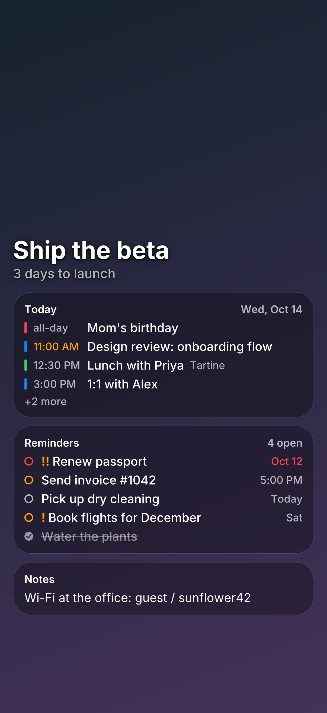
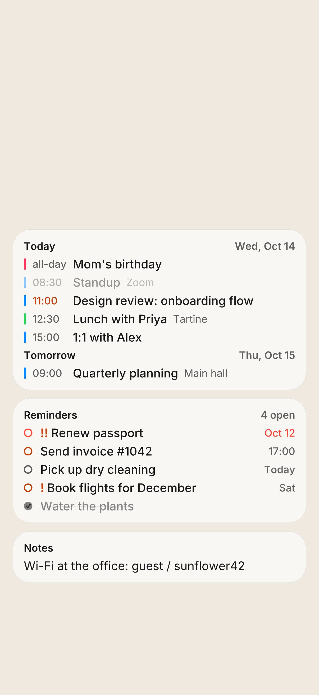
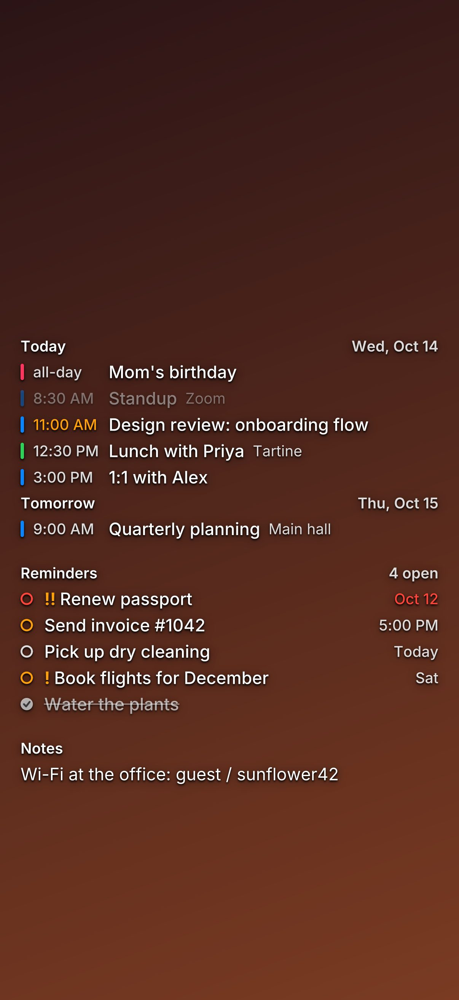
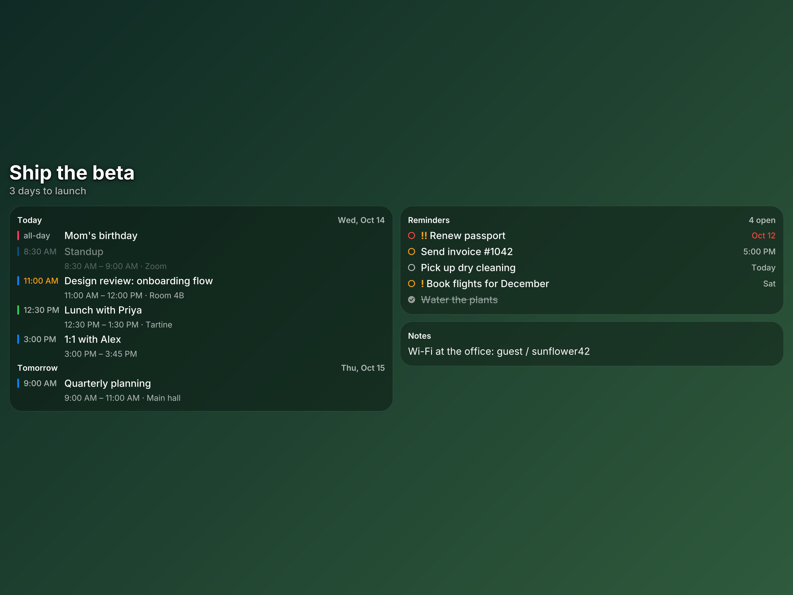

# Athvan

**Your day, on your lock screen.** Athvan is a small HTTP API that renders iPhone and iPad
wallpapers with your calendar events, reminders and notes drawn on top. You POST JSON and get
back an image at the device's native resolution. Pass it to iOS *Set Wallpaper* and your
schedule is one glance away, no unlock needed.

<p align="center">
  
  
  
</p>
<p align="center">
  
</p>

## Features

- **Every screen size.** Every iPhone from the SE to the 17 Pro Max and Air, and every current
  iPad, in portrait or landscape. Custom pixel sizes are accepted too.
- **Dense text that stays readable.** Text is sized in points, so it is the same physical
  size on every device. Compact mode gives one line per item. Content stays clear of the
  lock-screen clock and the flashlight/camera buttons.
- **Backgrounds:** solid colour, two-colour gradient, your own photo (URL or base64), or the
  **Bing image of the day** (any market, up to 7 days back, optional photo credit). Any of
  them can be blurred, dimmed or have its crop shifted.
- **Text styles:**
  - **glass**: frosted cards with adjustable tint, frost strength, corner radius and border
  - **shadow**: a soft halo that turns white behind dark text
  - **plain**: text only
- **Colours:** text, secondary, accent and overdue colours are all configurable.
- **Calendar-aware:**
  - Events are grouped under Today / Tomorrow / weekday headings.
  - Finished events are dimmed and the event in progress is highlighted.
  - Overdue reminders are red, and priorities show as `!` / `!!` / `!!!`.
  - When content doesn't fit, finished events are dropped first and the rest collapse into
    "+N more".
- **Preview page** to try every parameter live and copy the request as curl, JSON, a GET URL or
  an iOS Shortcut recipe.
- **Generated OpenAPI 3.1 spec.** The server validates requests against the same schema.
- **Invite-only access.** API keys are issued, revoked and monitored from an admin dashboard
  (use counts, last used, 30-day activity).
- **One self-contained binary.** Fonts, the preview page and timezone data are embedded.

## Quick start

Requires Go 1.26+.

```sh
git clone https://github.com/satlavida/athvan && cd athvan
go run ./cmd/athvan            # http://localhost:8080
```

With no admin configured the API is open, which is handy for local use. To make it
invite-only, see [Access & API keys](#access--api-keys).

Open <http://localhost:8080/> for the preview page, or render from the command line:

```sh
curl -X POST localhost:8080/v1/wallpaper -H 'Content-Type: application/json' -o wall.png \
  -H "Authorization: Bearer $ATHVAN_KEY" -d '{
  "device": "iphone-16-pro",
  "timezone": "America/Los_Angeles",
  "background": { "type": "bing" },
  "events": [
    { "title": "Design review", "start": "2026-10-14T10:00:00-07:00",
      "end": "2026-10-14T11:00:00-07:00", "location": "Room 4B", "color": "#0a84ff" }
  ],
  "reminders": [
    { "title": "Send invoice", "due": "2026-10-14T17:00:00-07:00", "priority": 2 }
  ],
  "notes": ["Wi-Fi: guest / sunflower42"]
}'
```

Use `-addr :9000` or `PORT=9000` to change the port.

## Endpoints

| Method & path | Description |
|---|---|
| `GET /` | Preview page |
| `GET /admin` | API key dashboard (see below) |
| `POST /v1/wallpaper` | Render a wallpaper from a JSON body. Returns `image/png` or `image/jpeg` |
| `GET /v1/wallpaper?config=…` | Same render; `config` is the body as base64url JSON. Good for a fixed bookmarkable look |
| `GET /v1/devices` | Device presets: resolution, scale, default safe areas (no key needed) |
| `GET /v1/bing?market=en-US&index=0` | Title, credit and URL of the Bing image |
| `GET /docs` | Interactive API reference |
| `GET /openapi.yaml` · `/openapi.json` | The OpenAPI 3.1 document |
| `GET /healthz` | Liveness check |

`/v1/wallpaper` and `/v1/bing` need an API key when keys are required. Without one they
return `401`.

Response headers on renders: `X-Athvan-Size`, `X-Athvan-Device`, `X-Athvan-Render-Ms`, and
`X-Athvan-Bing-Credit` when a Bing photo was used. Bad input returns `422` with
per-field errors. A failed remote image fetch returns `502`.

## Request reference

Every field is optional. An empty `{}` renders a plain dark wallpaper for the default device.
The full schema with ranges and descriptions is in [`openapi.yaml`](openapi.yaml) and at
`/docs`.

| Field | Default | Notes |
|---|---|---|
| `device` | `iphone-16-pro` | See `GET /v1/devices` |
| `orientation` | `portrait` | `landscape` swaps width and height (iPad) |
| `width`, `height`, `scale` | | Custom size in pixels instead of a preset; `scale` = pixels per point (default 3) |
| `format`, `quality` | `png`, `92` | `jpeg` is much smaller for photo backgrounds |
| `timezone` | server zone | IANA zone used for times and day grouping |
| `now` | current time | RFC 3339; used for Today/Tomorrow, dimming and overdue checks |
| `title`, `subtitle` | | Large heading above the cards |
| `events[]` | | `title`, `start`, `end`, `all_day`, `location`, `calendar`, `color`. A plain `YYYY-MM-DD` start means all-day |
| `reminders[]` | | `title`, `due`, `done`, `priority` (0–3), `flagged`, `list` |
| `notes[]` | | Free text, word-wrapped |
| `sections` | `events, reminders, notes` | Card order; leave one out to hide it |
| `background.type` | `color` | `color` · `gradient` · `image` · `bing` |
| `background.color`, `gradient_to`, `gradient_angle` | `#101418`, `#2a3a5c`, `160` | Colours are `#RGB`, `#RGBA`, `#RRGGBB` or `#RRGGBBAA` |
| `background.image_url` / `image_base64` | | JPEG, PNG, GIF or WebP; cover-cropped |
| `background.bing_market`, `bing_index`, `bing_caption` | `en-US`, `0`, `false` | |
| `background.blur`, `dim`, `focus_x` | `0`, `0`, `0.5` | Blur in points; dim 0–1; horizontal crop anchor 0–1 |
| `style.text_style` | `glass` | `glass` · `shadow` · `plain` |
| `style.text_color`, `secondary_color`, `accent_color`, `alert_color` | `#fff`, auto, `#ff9f0a`, `#ff453a` | Secondary defaults to the text colour at reduced opacity |
| `style.glass_tint`, `glass_blur`, `glass_radius`, `glass_border` | `#0000004d`, `30`, `22`, `#ffffff2e` | |
| `style.font_scale`, `density`, `time_format` | `1`, `compact`, `12h` | `comfortable` adds a second line with time ranges, locations, calendar and list names |
| `layout.top`, `layout.bottom` | device default | Fraction of the height kept clear (for the clock / bottom controls) |
| `layout.margin`, `align`, `columns`, `width` | `16`, `top`, auto, full | Columns: auto picks 2 on screens ≥ 600 pt wide |

## Access & API keys

Athvan is meant to be **invite-only**. Set an admin username and password and the server
starts requiring API keys:

```sh
ATHVAN_ADMIN_USER=you ATHVAN_ADMIN_PASSWORD='a long random password' go run ./cmd/athvan
```

Then open **`/admin`**, sign in, and use **Invite someone** to create a key. The dashboard:

- shows a new key **once**. Only its SHA-256 hash is stored, so a lost key can't be recovered;
  create a new one instead.
- lists every key with its name, note, prefix, creation date, last use, total uses and a
  30-day activity sparkline, plus totals for today, the last 30 days and all time
- lets you **revoke** a key (it stops working immediately), **restore** it, or **delete**
  revoked keys for good

Clients send their key in one of three ways. Prefer a header, since URLs end up in logs.

```
Authorization: Bearer athv_…
X-API-Key: athv_…
GET /v1/wallpaper?config=…&key=athv_…
```

While you are signed in to `/admin`, the preview page works without a key. Other visitors
paste their key into the preview page's toolbar; it is kept in that browser only.

Keys are stored in `$ATHVAN_DATA_DIR/keys.json` (default `./data`). Changes to the key set
are written immediately and usage counters every 5 seconds.

**Security notes:**

- Admin sessions use a random token in an `HttpOnly`, `SameSite=Strict` cookie, valid for
  12 hours. Sessions are held in memory, so a restart signs you out.
- State-changing admin requests must come from the same origin.
- After 5 failed logins, an IP is locked out for 15 minutes.
- Serve over HTTPS in production. The cookie is marked `Secure` behind TLS or when
  `X-Forwarded-Proto: https` is set.

## Updating it every day (iOS Shortcuts)

The preview page's **iOS Shortcut** tab shows this recipe already filled in with your current
settings.

1. **Find Calendar Events** where *Start Date is today* → *Repeat with Each* → build a
   Dictionary `{title, start, end, all_day, location}` (dates formatted as ISO 8601) → add it
   to a list variable.
2. **Find Reminders** where *Is Not Completed* → the same, with `{title, due, priority, list}`.
3. **Dictionary** holding your style settings, with `events` and `reminders` set to those
   lists.
4. **Get Contents of URL** `https://your-host/v1/wallpaper`, Method *POST*, Request Body *JSON*,
   Header `Authorization: Bearer <your key>`.
5. **Set Wallpaper** → Lock Screen. Turn off *Show Preview* so it runs unattended.

Trigger it from a **Personal Automation**, for example every morning at 6:00, or when you
dismiss your alarm. The phone has to be able to reach the server: deploy it somewhere, or use
your computer's LAN address while testing.

> iOS draws its own live clock on top of the wallpaper, so Athvan leaves the clock out and keeps
> its content below it. Adjust `layout.top` if your lock-screen widgets sit lower.

## OpenAPI

There is no hand-written spec. [Huma](https://huma.rocks) generates it from the Go types in
`internal/render/spec.go` and the operations in `internal/api/api.go`. The checked-in
[`openapi.yaml`](openapi.yaml) is a snapshot. Regenerate it after changing either file:

```sh
go generate ./...                                       # refresh openapi.yaml
go run ./cmd/athvan openapi -3.0 -o openapi-3.0.yaml    # downgraded for 3.0-only tooling
go run ./cmd/athvan openapi -json                       # JSON to stdout
```

## Deploy

```sh
docker build -t athvan .
docker run -p 8080:8080 -v athvan-data:/data \
  -e ATHVAN_ADMIN_USER=you -e ATHVAN_ADMIN_PASSWORD='…' athvan
```

The image is a static binary on distroless, running as non-root. Mount `/data` so keys
survive container restarts.

| Env var | Purpose |
|---|---|
| `PORT` | Listen port (default `8080`) |
| `ATHVAN_ADMIN_USER`, `ATHVAN_ADMIN_PASSWORD` | Enable `/admin`. Once set, API keys are required |
| `ATHVAN_REQUIRE_KEY` | `true`/`false` to override whether keys are required |
| `ATHVAN_DATA_DIR` | Where `keys.json` is stored (default `./data`, `/data` in Docker) |
| `ATHVAN_ALLOW_PRIVATE_URLS=1` | Let `image_url` reach loopback/private/link-local addresses. Off by default so a public deployment can't be used to probe its own network |

Exposing it publicly? Set the admin credentials so keys are required, and put it behind
HTTPS.

## Development

```sh
go test ./...                                   # every device × orientation, error cases, SSRF guard, keys, admin
go test ./internal/render -bench Render -run ^$ # ~0.25 s per iPhone render
```

```
cmd/athvan/         entry point: HTTP server and the `openapi` subcommand
internal/api/       Huma operations and key-auth middleware; the source of the OpenAPI document
internal/keys/      API key store (hashed keys, usage counters, JSON file)
internal/admin/     /admin dashboard: login, sessions, key management (not in the public spec)
internal/render/    request model, normalisation, layout, drawing, backgrounds, Bing
internal/devices/   iPhone / iPad presets and safe areas
internal/web/       preview page (one embedded HTML file, no build step)
docs/images/        README examples
```

## Credits

- Typeface: [Inter](https://rsms.me/inter/) by Rasmus Andersson, SIL Open Font License 1.1
  (`internal/render/fonts/Inter-LICENSE.txt`).
- Bing images belong to their photographers and agencies. Athvan fetches them at render time
  and doesn't redistribute them.
